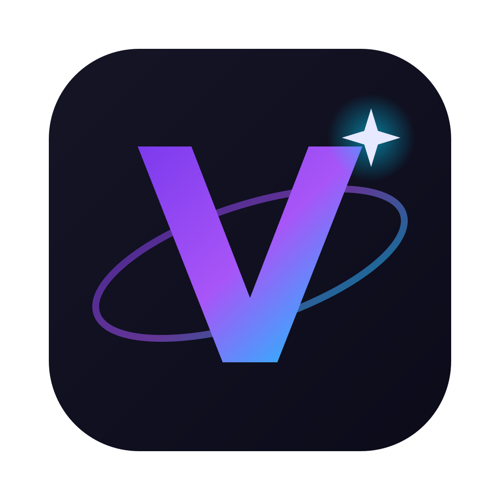

<p align="center">
  
</p>

<h1 align="center">VEGA</h1>

<p align="center"><strong>Code Beyond Limits.</strong><br>An independent, open-source, AI-powered code editor.</p>

---

VEGA is a fast, GPU-accelerated code editor built on the [Zed](https://github.com/zed-industries/zed) codebase. It keeps Zed's editor core and adds its own take on AI, sync and remote work, without any hosted service of its own:

- **Bring your own AI.** Use Anthropic, OpenAI, Google, OpenRouter, Ollama, LM Studio and more with your own keys, or models running on your machine. Keys stay in your OS keychain.
- **Settings Sync through GitHub.** Sign in with GitHub and your settings, keymap, tasks, snippets, themes and agent rules follow you to every machine through a secret gist in your own account. Changes merge setting by setting; secrets never leave the machine.
- **Deployment, built in.** Upload on save and compare with the server over SFTP, FTP/FTPS or WebDAV, PhpStorm-style (in progress).
- **No phoning home.** No telemetry, no crash uploads, no accounts on a VEGA server. VEGA never talks to Zed's servers.

VEGA is an independent project. It is not affiliated with or endorsed by Zed Industries, Inc. "Zed" is their trademark.

## Status

VEGA is in early development and has no releases yet; build it from source. See [`vega/ROADMAP.md`](vega/ROADMAP.md) for what's done and what's next.

## Building

VEGA is a Rust workspace. Install Rust with [rustup](https://rustup.rs) (the toolchain is pinned in `rust-toolchain.toml`), then:

```sh
cargo run                 # debug build and launch (the first build takes a while)
cargo run --release       # release build
```

Platform setup:

- [macOS](docs/src/development/macos.md): full Xcode (not only the Command Line Tools) and `cmake`. Without Xcode, `cargo run --features gpui_platform/runtime_shaders` compiles shaders at runtime instead. `script/vega-dev-app --build ~/some/project` runs the debug build as "VEGA Dev.app", so the Dock shows the VEGA icon.
- [Linux](docs/src/development/linux.md)
- [Windows](docs/src/development/windows.md)

Contributor guidelines for Rust and GPUI are in [`AGENTS.md`](AGENTS.md).

## Project docs

| Doc | What's in it |
|---|---|
| [`vega/ROADMAP.md`](vega/ROADMAP.md) | Phases, status, and every default VEGA changes from Zed |
| [`vega/SETTINGS_SYNC.md`](vega/SETTINGS_SYNC.md) | Settings Sync design |
| [`vega/DEPLOYMENT.md`](vega/DEPLOYMENT.md) | Deployment and Remote Host plan |
| [`vega/BRAND.md`](vega/BRAND.md) | Name, palette, icon |
| [`docs/`](docs/src) | User documentation |

## Licensing

VEGA keeps the licences of the code it builds on: GPL-3.0-or-later ([`LICENSE-GPL`](LICENSE-GPL)), with Apache-2.0 components where marked ([`LICENSE-APACHE`](LICENSE-APACHE)), such as GPUI. Each crate's `Cargo.toml` states its licence. Upstream copyright notices are kept.

License information for third-party dependencies must be correct for the license check to pass. Run `script/check-licenses` after adding dependencies. It uses [`cargo-about`](https://github.com/EmbarkStudios/cargo-about); if it fails:

- `no license specified` for a crate you created: add `publish = false` under `[package]` in its `Cargo.toml`.
- `failed to satisfy license requirements` for a dependency: check its license, and if it's acceptable add its SPDX identifier to the `accepted` list in `script/licenses/zed-licenses.toml`.
- `cargo-about` can't find a dependency's license: add a clarification at the end of `script/licenses/zed-licenses.toml`, as described in the [cargo-about book](https://embarkstudios.github.io/cargo-about/cli/generate/config.html#crate-configuration).

## Credits

VEGA is built on [Zed](https://github.com/zed-industries/zed) by Zed Industries and its contributors, and on the many open-source projects listed in its dependency licences.
